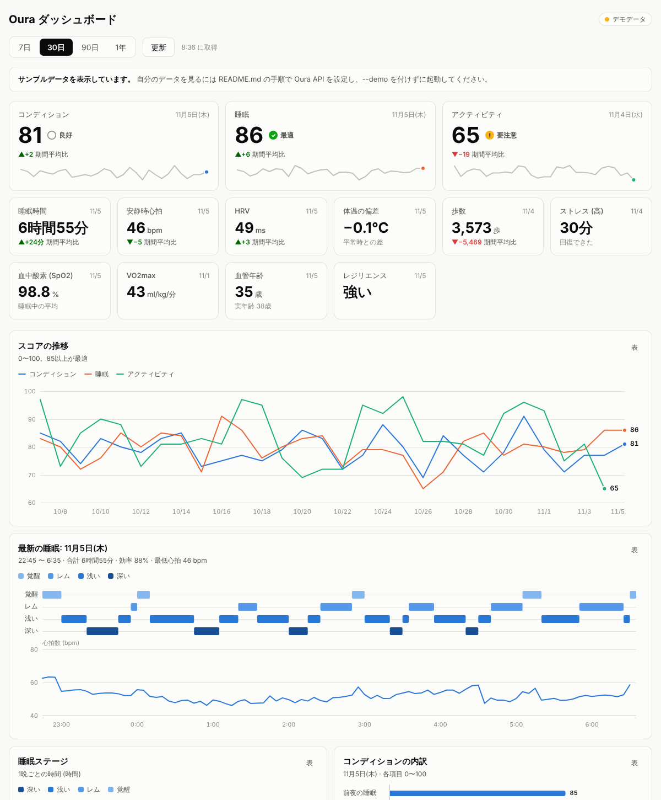

# Oura Ring 個人用ダッシュボード

[Oura API v2](https://cloud.ouraring.com/v2/docs) から自分のデータを読み、ブラウザで見るためのダッシュボードです。自分の PC 上で動かします。

Oura 公式のツールではありません。Oura (Ōura Health Oy) とは関係のない個人用ツールです。

- Python 3.9 以上だけで動きます (`pip install` は不要)
- グラフは外部ライブラリを使わず SVG で描いています
- 画面とサーバーは自分の PC の中 (`localhost`) だけで動きます。データやトークンが外部サービスに送られることはありません



*画像はサンプルデータです。*

## ダウンロード

```bash
git clone https://github.com/sashimisoba/OuraRingDashboard.git
cd OuraRingDashboard
```

## まずサンプルデータで見る

Oura の設定をしなくても、見た目と操作を試せます。

```bash
python3 server.py --demo
```

ブラウザで http://localhost:8765/ が開きます。終了は `Ctrl+C` です。Windows では `python3` の代わりに `py` を使ってください (以下同じ)。

`--sandbox` を付けると、Oura API の Sandbox (Oura が用意したテスト用データ) を本物の API から読みます。ログインは不要です。PC から Oura API に接続できるかを確かめるのに使えます。値は固定のテスト用データなので、グラフは単調な形になります。

```bash
python3 server.py --sandbox
```

## 自分のデータで使う

### 1. Oura にアプリを登録する

Oura は 2025年12月に Personal Access Token を廃止しました。今は自分のデータを読むだけでも OAuth2 のアプリ登録が必要です。

1. https://cloud.ouraring.com/oauth/applications を開き、Oura アカウントでログインします
2. 新しいアプリを作り、次のように入力します

   | 項目 | 入力する内容 |
   |---|---|
   | Display Name | `My Oura Dashboard` など (ログイン時の許可画面に出る名前) |
   | Description | `Personal dashboard that shows my own Oura data on my computer.` など |
   | Contact Email | 自分のメールアドレス |
   | Website / Privacy Policy / Terms of Service | このリポジトリの URL (`https://github.com/sashimisoba/OuraRingDashboard`) |
   | Redirect URIs | `http://localhost:8765/callback` (1文字でも違うとログインに失敗します) |
   | Scopes | すべてチェックしたままにする |

3. 保存すると **Client ID** と **Client Secret** が表示されます

ログイン時、このツールはアプリ登録でチェックしたスコープをそのまま求めます。Oura の許可画面では、データの種類ごとに共有のオン・オフを選べます。

登録したアプリは、承認前でも10人まで使えます。自分1人で使う分には承認は不要です。

### 2. `.env` に Client ID と Client Secret を書く

```bash
cp .env.example .env
```

`.env` を開いて値を入れます。

```
OURA_CLIENT_ID=ここに Client ID
OURA_CLIENT_SECRET=ここに Client Secret
```

`.env` は `.gitignore` に入っているので、git にコミットされません。

### 3. 起動してログインする

```bash
python3 server.py
```

開いたページで「Oura でログイン」を押し、Oura の画面でデータの共有を許可します。ダッシュボードに戻ると、データが表示されます。

ログイン情報 (アクセストークンとリフレッシュトークン) は `.oura_tokens.json` に保存されます。自分だけが読める権限 (600) で作成し、期限が切れたら自動で更新します。次回からはログインなしで開けます。右上の「ログアウト」でトークンを削除できます。

## 表示される内容

画面上部で期間 (7日 / 30日 / 90日 / 1年) を選ぶと、すべての表示がその期間に切り替わります。データは10分間キャッシュします。最新のデータを読み直すときは「更新」を押します。

| 表示 | 使う API | 内容 |
|---|---|---|
| スコア (上段) | `daily_readiness` `daily_sleep` `daily_activity` | 最新のコンディション・睡眠・アクティビティのスコアと、期間平均との差 |
| 指標 (2段目) | `sleep` ほか | 睡眠時間、安静時心拍、HRV、体温の偏差、歩数、ストレス、SpO2、VO2max、血管年齢、レジリエンス |
| スコアの推移 | 同上 | 3つのスコアの日ごとの変化 |
| 最新の睡眠 | `sleep` | 5分ごとの睡眠ステージと、睡眠中の心拍数 |
| 睡眠ステージ | `sleep` | 1晩ごとの深い・浅い・レム・覚醒の時間 |
| コンディション / 睡眠スコアの内訳 | `daily_readiness` `daily_sleep` | 最新日の各項目 (70未満に「要注意」) |
| HRV / 安静時心拍 | `sleep` | 睡眠中の平均 HRV と最低心拍の推移 |
| 体温の偏差 | `daily_readiness` | 平常時との差 |
| 歩数 | `daily_activity` | 1日の歩数 |
| ストレスと回復 | `daily_stress` | 「ストレス高」の時間 (上) と「回復」の時間 (下) |
| 直近24時間の心拍数 | `heartrate` | 5分ごとの心拍数 |
| ワークアウト | `workout` | 期間内のワークアウト一覧 |

- グラフにマウスを乗せると、その日の値が出ます。グラフを選択してキーボードの ← → でも動かせます
- 各カードの「表」を押すと、グラフを表に切り替えられます
- OS の設定に合わせてダークモードになります
- 権限がない、またはリングが対応していないデータは、そのカードだけ空欄になり、画面上部に理由が表示されます

## ファイル構成

```
OuraRingDashboard/
├── server.py        ローカルの Web サーバー (ログイン、API の中継、キャッシュ)
├── oura_api.py      Oura API クライアント (OAuth2 + PKCE、トークン更新、ページ送り、429 対応)
├── demo_data.py     --demo 用のサンプルデータ (API と同じ形)
├── static/          画面 (index.html, app.js, charts.js, style.css)
├── tests/           テスト (偽の Oura サーバーを使うのでネット接続は不要)
├── .env.example     設定ファイルのひな形
└── docs/            README 用の画像
```

### 仕組み

```
ブラウザ ──> server.py (localhost:8765) ──> api.ouraring.com
             └ .oura_tokens.json にトークンを保存
```

- ブラウザから直接 Oura API を呼ばず、`server.py` が間に入ります。Client Secret とトークンをブラウザに渡さないためです
- サーバーは `127.0.0.1` だけで待ち受けます。`Host` ヘッダーが `localhost` / `127.0.0.1` 以外のリクエストは拒否します (DNS リバインディング対策)
- 1回の表示で、期間内のデータを API ごとに1回ずつ読みます (10分キャッシュ)。Oura が推奨する Webhook は、外部から届く URL が必要なので使っていません。個人で使う分にはレート制限に届きません

## 設定項目 (`.env`)

| 名前 | 既定値 | 説明 |
|---|---|---|
| `OURA_CLIENT_ID` | なし (必須) | アプリの Client ID |
| `OURA_CLIENT_SECRET` | なし (必須) | アプリの Client Secret |
| `OURA_REDIRECT_URI` | `http://localhost:<OURA_PORT>/callback` | Oura に登録した Redirect URI と同じ値 |
| `OURA_SCOPES` | なし (アプリ登録でチェックしたスコープをすべて求める) | 求める権限を絞るときに、スペース区切りで指定する (例 `daily heartrate personal`) |
| `OURA_PORT` | `8765` | 変えるときは Redirect URI も合わせて変更し、Oura 側の登録も直す |
| `OURA_TOKEN_FILE` | `.oura_tokens.json` | トークンの保存先 |

## 困ったとき

| 症状 | 確認すること |
|---|---|
| ログイン後に「Redirect URI Does Not Match」などと出る | Oura に登録した Redirect URI と `.env` の `OURA_REDIRECT_URI` が完全に同じか (`localhost` と `127.0.0.1`、末尾の `/` の有無も区別されます)。Oura の登録画面が `localhost` を受け付けない場合は `http://127.0.0.1:8765/callback` を両方に設定し、ブラウザで http://127.0.0.1:8765/ を開いてください |
| 原因が分からない | ログインしたあと、サーバーを止めて `python3 server.py --check` を実行します。データの種類ごとに読めたかどうかと、Oura が返したエラーの内容を表示します (トークンは表示しません) |
| ログイン時に `invalid_scope` | `.env` に `OURA_SCOPES` を書いている場合は消すか、アプリ登録でチェックしたスコープだけにする |
| 一部のカードが空で「Missing Scopes」と出る | そのデータを読む権限がありません。アプリ登録でそのスコープにチェックが入っているか確認し、右上の「ログアウト」からログインし直して、許可画面で共有をオンにする |
| 一部のカードが空で「403」と出る | Oura の許可画面でそのデータの共有をオフにした、Oura メンバーシップが切れている、またはリングが対応していない |
| 「Oura にデータの読み取りを断られました」 | どのデータも 401 で拒否されました。表示されたエラーの内容を確認し、もう一度ログインしてください。続くときは `--check` の結果を確認する |
| 今日の睡眠が出ない | 睡眠データは Oura アプリを開いて同期したあとに API に反映されます。アプリを開いてから「更新」を押す |
| 「ログインの有効期限が切れました」 | リフレッシュトークンは1回しか使えません。同じトークンを別のツールでも使っていると無効になります。もう一度ログインしてください |

## テスト

```bash
python3 -m unittest discover -s tests
```

偽の Oura サーバーを立てて、ログイン (state と PKCE の検証)、トークンの保存と自動更新、同時更新の排他、ページ送り、429 の待機、一部 API の失敗、Host ヘッダーの検査、静的ファイルのパス検査を確認します。ネット接続は不要です。

本物の Oura API (Sandbox) に接続するテストも用意しています。アカウントは不要です。

```bash
OURA_SANDBOX_TEST=1 python3 -m unittest discover -s tests
```

## Oura API のメモ

- 認証: `https://cloud.ouraring.com/oauth/authorize` → `https://api.ouraring.com/oauth/token`。リフレッシュトークンは使い捨てで、更新のたびに新しいものが返る
- すべてのリクエストに `User-Agent` が必要 (ないと 403 になることがある)
- 日ごとのデータは `start_date` / `end_date`、心拍数は `start_datetime` / `end_datetime` で期間を指定する。`end_date` の日が含まれない API があるため、このツールは1日多めに取得している
- 1ページに収まらないと `next_token` が返るので、それを付けて次のページを読む
- `sleep` の `day` は「起きた日」。昼寝 (`late_nap` など) も含まれるので、各日の `long_sleep` を主な睡眠として扱っている
- 5分ごとの睡眠ステージは `sleep_phase_5_min` が空で `app_sleep_phase_5_min` にだけ入っていることがある。このツールは `app_sleep_phase_5_min` (アプリの表示に合わせた方) を優先し、なければ `sleep_phase_5_min` を使う
- ワークアウトの `label` が文字列の `"None"` で返ることがある (Sandbox で確認)。その場合はラベルなしとして扱う
- Sandbox は `/v2/sandbox/usercollection/...` で、`Authorization` ヘッダーに任意の文字列を入れれば使える。`personal_info` はない
- API 仕様書 (OpenAPI): https://cloud.ouraring.com/v2/static/json/openapi-1.43.json
